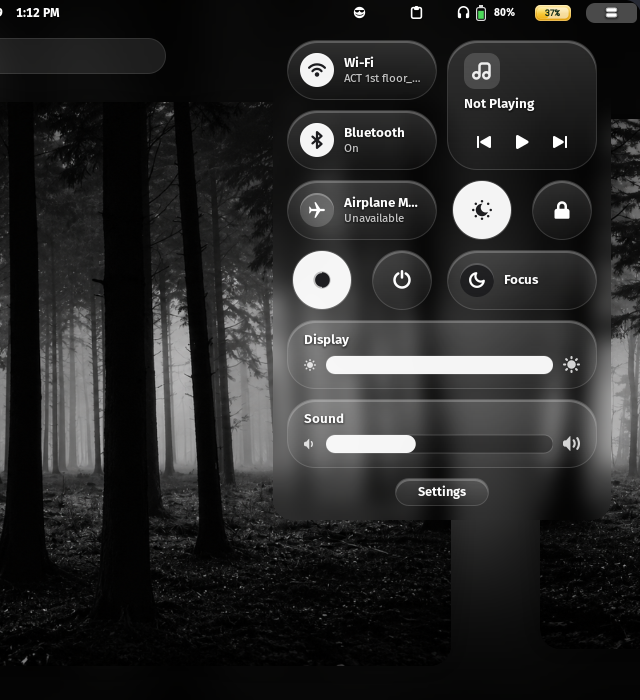
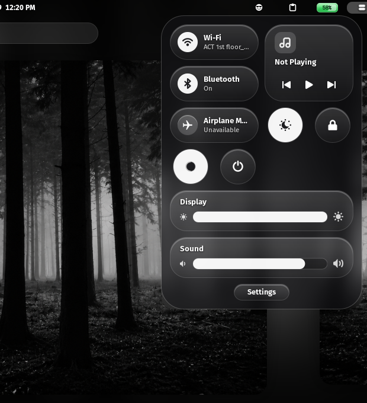
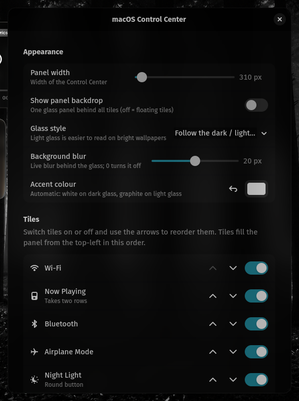

# macOS Control Center

A GNOME Shell extension that replaces the Quick Settings menu with a macOS 26 (Tahoe) style glass Control Center: floating frosted tiles, a battery popover, light/dark glass, accent colour, and configurable tiles.

The glass is a real, live backdrop blur — not a static frost — and its strength is adjustable from the preferences.



## Features

- macOS-style glass Control Center in place of Quick Settings
- **Live backdrop blur** behind every tile and button
  - Uses the system `Blur` library when it is available, so the blur is trimmed to the rounded corners; falls back to `Shell.BlurEffect` on shells without it
  - Strength slider from 0 to 40 px — 0 switches the effect off completely
  - Optional "panel backdrop" mode: one glass panel behind all tiles instead of floating ones
- Wi-Fi and Bluetooth tiles with detail views: pick a network and connect (with password entry), manage devices
- Now Playing tile with album art and MPRIS playback controls
- Airplane Mode and Focus tiles
- Round buttons: Night Light, Lock Screen, Dark/Light Mode, Power Menu, Screenshot, Screen Recording
- Display brightness and sound volume sliders
- Settings button
- Battery glyph in the top bar: click it for time remaining and power mode
- Glass style — follow the dark/light toggle, always dark, or always light
- Accent colour for active toggles (or automatic white/graphite)
- Choose which tiles are shown, and reorder them

With the panel backdrop enabled, the whole menu is blurred once instead of every tile:



## Preferences



- **Panel width** — 300–460 px
- **Show panel backdrop** — one glass panel behind all tiles, or floating tiles
- **Glass style** — follow the dark/light toggle, always dark, always light
- **Background blur** — 0–40 px (0 = off)
- **Accent colour** — pick a colour, or use the automatic one
- **Tiles** — switch tiles on or off and reorder them with the arrows

## Installation

1. Download the [latest release](https://github.com/Ashishranjan980/macos-control-center/releases/latest) (`macos-control-center@ashishranjan.zip`).
2. Install the archive:

   ```sh
   gnome-extensions install --force macos-control-center@ashishranjan.zip
   ```

3. Log out and log back in — GNOME Shell only loads changed extension code at startup.
4. Enable it if needed:

   ```sh
   gnome-extensions enable macos-control-center@ashishranjan
   ```

## Requirements

- GNOME Shell 45–51 (developed and tested on GNOME 50, Wayland)
- Optional: the `Blur` library (`libblur-effect`) for rounded-corner blur. Without it the extension falls back to `Shell.BlurEffect` — the same blur, but the blurred rectangle keeps square corners underneath the rounded backgrounds.

## Note

If you also run another blur extension (for example *Blur my Shell*), avoid enabling its popup blur for this menu — the two would blur on top of each other.
